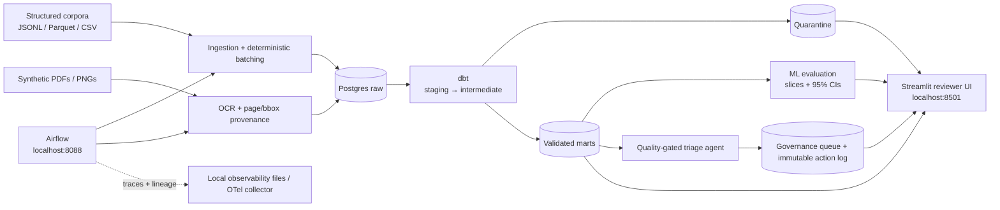

# PII Hygiene Capstone

A local-first data platform for ingesting structured and OCR-derived PII records,
validating them with dbt, evaluating deterministic and local NER detectors, and routing
quality-gated review work through an audited triage agent.

The default runtime is entirely local: Postgres 16, Apache Airflow, OpenTelemetry, dbt,
and Streamlit run through Docker Compose. Downloading the four real corpora is optional;
the pipeline can run with synthetic fixtures. Data and generated documents are intentionally
not committed.

> **Cloud status — UNVERIFIED:** Snowflake, BigQuery, GCP/Cloud Composer, Kubernetes, and
> Helm material describe portability targets only. No cloud deployment or cloud result is
> verified by this repository's local test evidence.

## Architecture



The structured mart is one row per validated `document_key`; spans remain in a separate
fact table to prevent join fan-out. Invalid structured and OCR records are split-routed to
quarantine. dbt test failure gates ML evaluation and agent execution in the Airflow DAG.

See `docs/architecture.md` for component boundaries and data flow. **UNVERIFIED cloud
portability:** the Snowflake, BigQuery, GCP, and Kubernetes mappings in `docs/` and `helm/`
are design guidance, not proof of a deployed system.

## Quickstart

Prerequisites: Docker with Compose v2 and enough local disk for the images and generated
data. Optional host-side development requires Python 3.12, a virtual environment, and
system OCR/PDF dependencies used by `pytesseract` and PyMuPDF.

```bash
cp .env.example .env
docker compose up -d --build
docker compose ps
```

Open:

- Airflow: <http://localhost:8088> (`admin` / `admin`, local development only)
- Streamlit: <http://localhost:8501>
- Postgres: `127.0.0.1:5433`, database `pii_lab`

On a fresh checkout, generate the offline fixtures before triggering the demo:

```bash
docker compose exec airflow-scheduler python -m ingestion.download_sources --offline-fixtures
```

In Airflow, unpause and trigger `pii_hygiene_pipeline`. For a fast demonstration, use:

```json
{
  "batch_id": "smoke_001",
  "limit_per_source": 2000,
  "doc_count": 60,
  "max_agent_actions": 40,
  "eval_max_docs": 4000
}
```

The fast configuration is a functional smoke run and is **not** expected to prove the
1,000,000-document acceptance criterion. Use `limit_per_source: 0` and
`doc_count: 1000` for the full run after making the source data available. Corpus downloads
can be several gigabytes and may require Hugging Face authentication or acceptance of
dataset terms. If PII-SCOPE is inaccessible, the ingestion contract uses an explicitly
identified synthetic fixture and does not present it as the real corpus.

Follow progress without changing state:

```bash
docker compose logs -f airflow-scheduler airflow-webserver
```

To stop the stack while retaining volumes:

```bash
docker compose down
```

Do not use `make reset` unless you intend to destroy local containers, warehouse volumes,
and generated staged/unstructured data.

## Host development

With the warehouse running in Docker:

```bash
python3.12 -m venv .venv
.venv/bin/pip install -r requirements-worker.txt -r requirements-dbt.txt -r requirements-app.txt
PII_DB_HOST=127.0.0.1 PII_DB_PORT=5433 scripts/run_local_pipeline.sh --quick --batch-id smoke_001
```

Host commands default to Postgres at `127.0.0.1:5433`. Container services use
`warehouse:5432`. Configuration belongs in `.env`; never commit `.env`, credentials,
downloaded corpora, generated PDFs/PNGs, or model artifacts.

## One-million-document proof

The project does not treat a configured target or raw row count as evidence. After a full
pipeline run, execute this query against the validated document-grain mart:

```bash
docker compose exec warehouse psql -U pii_admin -d pii_lab -c "
SELECT
  COUNT(*) AS mart_rows,
  COUNT(DISTINCT document_key) AS unique_document_keys,
  COUNT(*) = COUNT(DISTINCT document_key) AS one_row_per_document,
  COUNT(DISTINCT document_key) >= 1000000 AS meets_one_million
FROM marts.fct_pii_documents;"
```

Source-level evidence:

```sql
SELECT
    source_dataset,
    COUNT(*) AS mart_rows,
    COUNT(DISTINCT document_key) AS unique_document_keys,
    MAX(ingested_at) AS last_refreshed
FROM marts.fct_pii_documents
GROUP BY source_dataset
ORDER BY unique_document_keys DESC;
```

Both `one_row_per_document` and `meets_one_million` must be true. This proof covers only
validated rows that reached `marts.fct_pii_documents`; quarantined records are intentionally
excluded.

## Demo commands

Run the quick host pipeline:

```bash
make quick BATCH=smoke_001
```

Exercise quarantine routing with the three-record defect sample:

```bash
make quarantine-demo
```

Exercise the greater-than-5% circuit breaker (a failing dbt test is expected):

```bash
make flood-demo
```

Run the Streamlit app on the host:

```bash
make app
```

Verify acceptance criteria and collect warehouse-backed evidence after a completed run:

```bash
PII_DB_HOST=127.0.0.1 PII_DB_PORT=5433 .venv/bin/python -m scripts.verify_acceptance
make evidence
```

The triage agent reads validated marts only and requires the latest recorded dbt status to
be `PASS`. Its four normal decisions are allowlisted and every decision is written to
`governance.agent_action_log`. External GitHub issue creation is disabled unless both
optional sandbox variables are set.

## Evidence

The [Docker Compose scale run](docs/scale-verification.md) completed with
1,375,254 distinct validated documents, 500 OCR source files, and 39 audited
review tasks. See [local quarantine verification](docs/quarantine-verification.md)
for the separate bad-record and circuit-breaker demonstrations.
The scale run used a synthetic CSV stand-in for gated PII-SCOPE. Cloud
deployments have not been verified.

`make evidence` writes `docs/evidence.md` and records query results, generation time, Git
revision, and warehouse endpoint. Review that file before citing any metric. The executable
acceptance checklist exits nonzero when a criterion is not met.

## Tests and quality checks

```bash
.venv/bin/ruff check .
.venv/bin/python -m pytest tests -q
.venv/bin/dbt parse --project-dir dbt_pii_hygiene --profiles-dir dbt_pii_hygiene --target postgres
docker compose config --quiet
```

Database integration tests skip when no test database is available. The dbt data tests
require a populated local warehouse.

## Documentation

- `docs/architecture.md` — local components, trust boundaries, and flow
- `docs/data-dictionary.md` — table grain and important columns
- `docs/operations.md` — runbook and failure handling
- `docs/ml-evaluation.md` — split, metrics, slices, and limitations
- `docs/agent-policy.md` — quality gate, decisions, tools, and audit behavior
- `docs/snowflake-port.md` — **UNVERIFIED** Snowflake portability guidance
- `docs/gcp-portability.md` — **UNVERIFIED** GCP/BigQuery portability guidance
- `CONTRIBUTING.md` — development and contribution workflow

## License

Apache License 2.0. See `LICENSE`.
